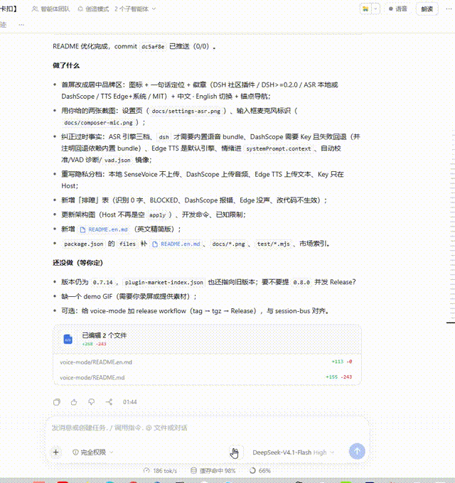
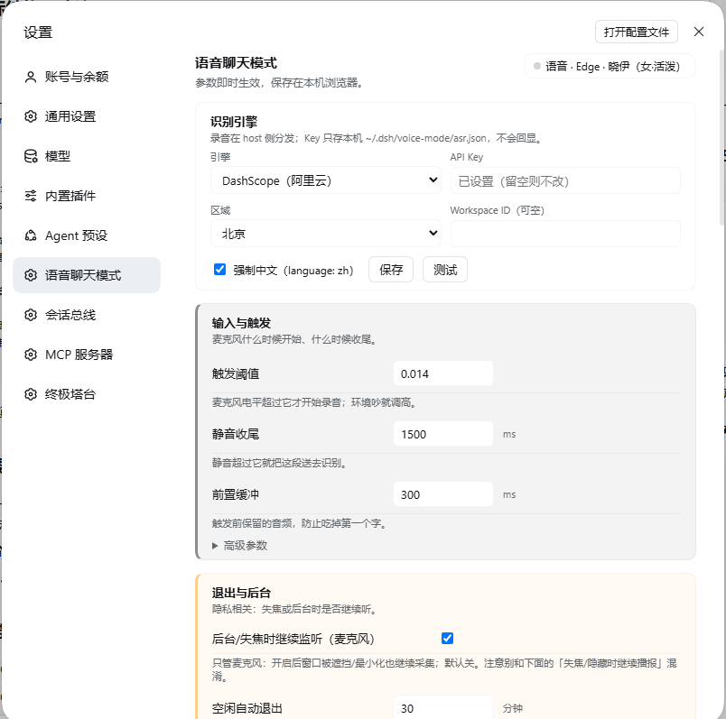

<div align="center">


# dsh-voice-chat-mode

**A voice-chat mode for DeepSeek Harness** — speak and it records, transcribes and submits automatically; replies are read aloud with Edge TTS or system speech, with multi-part `[voice-note]` scripts.


[中文](README.md) · **English**

[Features](#features) · [Install](#install) · [Quick start](#quick-start) · [ASR engines](#asr-engines) · [Privacy](#privacy-and-security) · [Troubleshooting](#troubleshooting)

</div>

DSH's built-in voice input can transcribe, but the interaction chain is missing: always-on listening, auto submit, switchable cloud ASR, voice-note scripts, and a model-controlled microphone. This plugin connects them, with one rule: **audio is transcribed locally by default; the cloud engine is opt-in**.





## Features

- Always-on VAD listening (RMS threshold + minimum speech time) with automatic record/stop.
- Auto-submit via `beginSubmission` + `prompt`; `queue` by default, long-press to mark the next utterance as `steer`.
- ASR engines: `dsh` (built-in local SenseVoice, no key), `dashscope` (Aliyun Qwen ASR, key required, auto-fallback to dsh), `off`.
- VAD auto-calibration (floor 0.008, drop warning, undo) and `vad` diagnostic rows (voiced ratio, peak, p90).
- Edge TTS (8 Chinese voices) or system `speechSynthesis`, with automatic fallback.
- Multi-part `[voice-note]: <…>` blocks, read in order; falls back to the first 3 sentences of the reply.
- `voice_mode` tool: enable / disable / speak / status.
- DashScope `emotion` / `language` exposed to the model as `lastVoiceEmotion` in `systemPrompt.context` (5-minute expiry).

## Install

Requires DSH >= 0.2.0. Plugin page → Add plugin, paste:

```text
https://github.com/BeepFlyer/dsh-voice-chat-mode
```

or CLI:

```sh
dsh plugin --profile desktop add github:BeepFlyer/dsh-voice-chat-mode
```

| Dependency | Needed when | Notes |
|---|---|---|
| `dsh-experimental-voice-input-bundle` + models | `engine=dsh` only | local SenseVoice (~230 MB, downloaded by DSH) |
| DashScope API key | `engine=dashscope` only | saved host-side in `~/.dsh/voice-mode/asr.json`, never echoed |
| Edge TTS Python package | `tts=edge` (default) | vendored in `vendor/python`; auto-installed if missing |
| `speechSynthesis` | fallback/offline | OS-provided, no dependency |

## Quick start

Install, enable, refresh the page → Settings → Voice chat mode → choose ASR engine → click the microphone in the top bar → say “测试测试” → the message arrives as `[语音] 测试测试` → the assistant's `[voice-note]` blocks are spoken.

If recognition returns 0 characters, run **Auto-calibrate**, check the OS microphone gain, and read the `vad` diagnostic row (`voicedRatio` low means quiet input or a wrong threshold).

## ASR engines

| Engine | Where | Key | Fallback |
|---|---|---|---|
| `dsh` | local SenseVoice (CPU) | no | BLOCKED until models are ready |
| `dashscope` | Aliyun Qwen ASR | yes | falls back to `dsh`; `fallbackFrom=dashscope-*` in diagnostics |

> The fallback target is `dsh`, so the built-in voice bundle and models must be available for fallback to work. If the bundle was removed, a cloud failure has no local fallback.
| `off` | none | — | TTS only |

DashScope sends **audio** to Alibaba Cloud; choose `dsh` if you do not want audio to leave the machine. Edge TTS sends only the **text to be spoken** to Microsoft; system speech is fully local.

## Privacy and security

- Local ASR: audio stays between the browser and the loopback host interface; SenseVoice runs on the host CPU.
- DashScope: audio is uploaded to Alibaba Cloud only when you explicitly select it.
- Edge TTS: text is sent to Microsoft's Edge read-aloud endpoint (HTTPS); system speech is offline.
- API keys live in `~/.dsh/voice-mode/asr.json` on the host, are never echoed to the client, and never enter logs.
- Host routes sit behind the `/api` auth fence; no telemetry; diagnostics stay local.

## Troubleshooting

| Symptom | First check |
|---|---|
| 0 characters recognized | mic gain / volume, auto-calibrate, `vad.voicedRatio` and `p90Rms` |
| Never triggers | threshold too high; `peakRms` in diagnostics |
| `state=BLOCKED` | mic permission, another window holding the lock, built-in ASR models not prepared |
| DashScope errors | Settings “Test”, `asr.fallbackFrom`, key/region/workspace |
| Edge TTS silent | dependency status, `edge tts failed` in diagnostics, `python -m edge_tts --list-voices` |
| Changes not taking effect | refresh the page for client changes; reload the plugin for host changes |

## Development

```bash
node scripts/build-client.mjs      # regenerate client.js from client-body.js
node scripts/build-client.mjs --check
node test/host-route.mjs && node test/edge-player.mjs && node test/tools.mjs
```

`client-body.js` is the source; `client.js` is generated. Diagnostics: `~/.dsh/voice-mode/diag-YYYY-MM-DD.jsonl`; calibration threshold is mirrored to `~/.dsh/voice-mode/vad.json`.

## Limitations

- Verified on Windows 10/11 + DSH Desktop; web profile should work with loopback + mic permission.
- No wake word, streaming captions, or voice cloning.
- Emotion/language only come from DashScope; local SenseVoice does not return them.
- This plugin replaces the built-in `ui-voice-input` row; do not enable both microphones at once.

## License

MIT.
