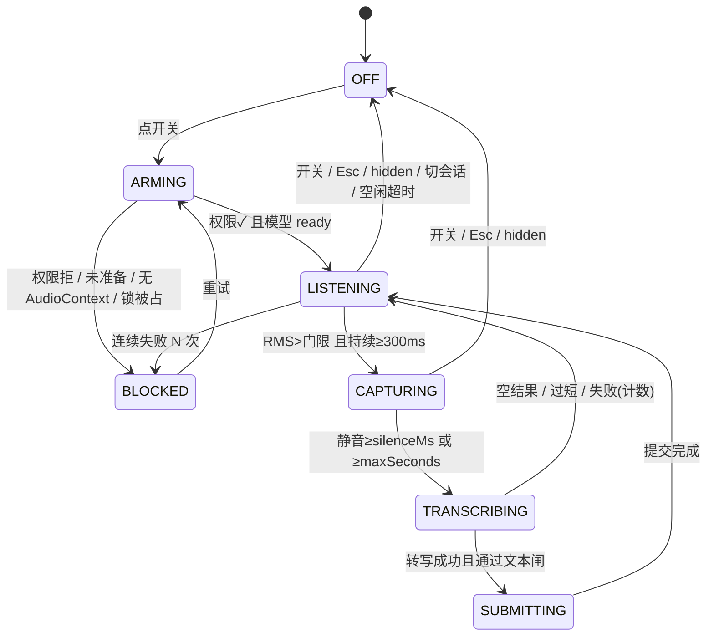

# voice-mode · DSH 语音聊天模式插件

给 [DeepSeek Harness](https://github.com/deepseek-ai/deepseek-harness)（DSH）加一个**语音聊天模式**：说话自动触发录音、自动转写、自动提交；助手回复用 Edge TTS 或系统语音念出来（支持口播稿协议）。复用 DSH 内置语音栈做识别，只额外加一层很薄的 Host 路由（Edge TTS 与模型控制工具）。

> 状态：可用（v0.7.12）。Windows 10 + DSH Desktop 实测：说话→本地转写→自动提交→Edge TTS 播报闭环；设置页卡片化 + 右侧预览；模型可用 `voice_mode` 工具主动开麦/说话。

## English summary

`voice-mode` is a client-side plugin for DeepSeek Harness that adds a voice-chat mode:

- always-on VAD listening (`getUserMedia` + AudioContext), automatic recording and transcription through DSH's authenticated `speechToText` remote;
- automatic submission into the current session (`beginSubmission` + `prompt`, `queue` by default; long-press to `steer`);
- spoken replies through **Edge TTS** (thin Host route + MP3 playback) or the system `speechSynthesis`, with per-turn coalescing, sentence splitting, prefetch and immediate stop;
- a `voice_mode` model tool (enable / disable / speak / status) that lets the agent open the microphone or read text in automated flows;
- explicit `[voice-note]` blocks: the agent may emit several per reply and each is spoken in order;
- voice notes also play while the mic is off (v0.7.11): assistant messages are watched even when the mode is idle, so `[voice-note]` blocks are read out; body-text fallback stays active only while listening;
- session-scoped state, hard-off paths (toggle / `Esc` / hidden / session switch / refresh), `navigator.locks` arbitration across windows, ~20 tunable settings.

It replaces the built-in `ui-voice-input` row (see the maintenance header in `cordis.patch.yml`), reuses DSH's built-in experimental voice stack for local transcription (models are downloaded per user by DSH, never shipped or shared by this plugin), and adds a thin Host route for Edge TTS plus the `voice_mode` tool. License: MIT.

---

## 特点（为什么选它）

- **零自建识别服务**：转写直接用 DSH 内置语音栈（本地 SenseVoice + `speechToText`），不需要 API key、不用部署 ASR 服务——代价是必须启用 DSH 的实验语音 bundle；
- **口播稿优先**：模型用 `[voice-note]: <…>` 显式给出“该念的段落”，一轮可多段、按出现顺序朗读；没有口播稿才回退念正文前 3 句；
- **双引擎播报**：Edge TTS（8 个中文音色，默认晓伊 +10%）与系统语音一键切换；请求失败自动回退，断网也有声；
- **模型可控制**：`voice_mode` 工具让模型主动开麦（enable）、关麦（disable）、说话（speak）、查状态（status），适合自动化流程与“边跑边报进度”；
- **状态归属清晰**：会话级开关、切会话自动恢复、后台/失焦可配置、硬关闭路径明确（`Esc` / hidden / 切会话 / 刷新）；播报中失焦默认不掐断；
- **轻量**：无运行时 npm 依赖、不额外分发模型（模型由 DSH 语音 bundle 管理）；Host 侧只有一条 `/api` Fetch 路由 + 一个工具；
- **可维护**：设置页卡片 + 右侧实时试听、依赖自检、诊断日志；覆盖内置行处带维护注释，升级 DSH 时有据可查。

## 与其他语音插件的关系

同类不少（`dsh-voice-mode` 功能最全、`dsh-voice` 偏朗读、`dsh-voice-chat` / `dsh-voice-talk` 偏对话式）。本插件的取舍是**不重复造 ASR/TTS 服务，只把 DSH 内置语音栈接到最顺的交互上**（常驻监听、自动提交、口播稿、模型工具）；对应地，它要求内置实验语音 bundle 可用，也不提供唤醒词、流式字幕、音色克隆这些专项能力。

## 功能

- **常驻监听**：VAD（RMS 门限 + 最短语音时长）自动开始/结束录音，不需要点按钮；
- **自动提交**：转写文本走会话的 `beginSubmission` + `prompt`，默认 `queue`；长按开关 500ms 可把下一次说话标记为 `steer`（插话）；
- **语音播报（TTS）**：用系统 `speechSynthesis` 念助手最终回复，默认只念**口播稿**，没有口播稿时回退「前 3 句」；
- **多段口播**：一条回复可在不同阶段放多段 `[voice-note]`，按出现顺序逐段念；
- **未开麦也播报**（v0.7.11）：模式是关闭/待机时，显式的口播稿照样念出来——消息监听不再只在模式运行中才挂。只念口播稿，不念正文兜底（那是模式运行中才做的事）。设置页 TTS 组可关，关掉便回到「先攒着、开麦再补」。
- **打断判定**：播报中被声音触发打断时先记下剩余内容再停播；转写结果为空/纯语气词就恢复播报，只有有效发言才真正打断并提交（v0.6.6）；
- **会话级状态**：切走会话停麦、切回自动恢复（2 秒提示）；刷新/重载回 `OFF`；
- **硬关闭**：短按开关 / `Esc` / 切标签 / 刷新；空闲与失焦退出可配（0 = 不自动退出）；**切换会话只停麦，不打断正在播的回复**（v0.7.1）；
- **设置页**：20 项参数、诊断日志、「播放测试」；
- **多窗口仲裁**：`navigator.locks` 按会话加锁，另一个窗口占用时置灰并说明。

## 一键理解状态机



叠加位（不是停留态）：`speaking`（播报中 → 抑制触发）、`pending`（该会话有回合在跑 → 提交仍走 queue）。

## 播报引擎（v0.2.0）

播报有两种引擎，设置页「语音回复 → 播报引擎」切换：

| 引擎 | 说明 | 依赖 |
|---|---|---|
| `edge`（默认） | Edge TTS 神经语音，8 个中文音色；默认 `zh-CN-XiaoyiNeural` + `+10%` 语速（已试听定稿） | 联网 + DSH 自带 Python 里的 `edge-tts` |
| `system` | 本机 `speechSynthesis`（离线、音色旧） | 无 |

安装 `edge-tts`（一次性）：

```powershell
$py = 'C:\Users\Lenovo\.dsh\dsh-runtimes\dsh-primary-runtime\dependencies\python\python.exe'
& $py -m pip install edge-tts -q -i https://pypi.tuna.tsinghua.edu.cn/simple
& $py -m edge_tts --list-voices   # 能跑通即正常
```

链路：客户端按句 `POST /api/voice-mode.tts` → Host 子进程 `python -m edge_tts` → `audio/mpeg` → 客户端 `Audio(blob)` 播放。带 50 条内存 LRU、20 次/分钟限流、10s 单句超时、预取下一句。

失败回退：断网 / 超时 / 404 / 503 时自动切回系统语音（设置项可关），诊断记一条 `edge tts failed: …`。

顶栏有两个独立入口：**麦克风开关**（输入）与 **「朗读/静音」键**（只控制助手回复自动朗读，立即生效并持久化；工具 `speak` 不受它影响）。播报中点顶栏或 `Esc` 仍只停当前这一句。

> 非官方接口：Edge TTS 是微软 Edge 朗读用的端点，可能变更或失效；`speechSynthesis` 回退是安全带。仅供本机个人使用。

维护提示：升级 `edge-tts` 或换机器后，先跑 `--list-voices`；若失效，Host 返回 503 并在诊断里提示「需安装 edge-tts」。

## 模型控制（v0.3.0）

Host 半身注册了一个模型工具 `voice_mode`，并给客户端开了一个命令队列，模型可以在自动化流程里：

| action | 作用 |
|---|---|
| `enable` | 在**当前打开的会话**里打开麦克风（进入 LISTENING） |
| `disable` | 关闭语音模式（停麦、停播、放锁） |
| `speak` | 让客户端用当前 TTS 引擎念一段文本（≤500 字，不要求语音模式开着） |
| `status` | 返回窗口最近一次回报的状态（state / speaking / sessionId / detail） |

机制：工具把命令放进 Host 内存队列；浏览器插件每 **1.5s** 轮询 `GET /api/voice-mode.control` 取走并执行，随后 `POST` 回报状态。因此工具返回的是“已入队”，不是同步结果；`status` 反映最近一次轮询。

注意：

- `enable` 需要窗口里有一个打开的会话（header 已挂载）；没有会话会被忽略并在诊断里记一条；
- 这会允许模型**主动开麦**——只在你要求（或自动化流程明确需要）时使用；
- 命令队列上限 10 条，超过丢最旧的。

## 参数（设置页可改，存本机 localStorage）

| 参数 | 默认 | 说明 |
|---|---|---|
| 触发阈值（RMS） | 0.01 | 高于它才认为在说话 |
| 最短说话时长 | 300ms | 短于此不触发，防键盘声 |
| 前置缓冲 pre-roll | 300ms | 触发前保留的音频，防止吃掉第一个字 |
| 静音收尾 | 1500ms | 静音超过它就收尾送识别 |
| 提交冷却 | 500ms | 提交后短暂忽略触发，防自激 |
| 单段上限 | 60s | 一段最长录音 |
| 最短字数 | 2 | 文本闸：短于此丢弃 |
| 连续失败上限 | 3 | 到数停麦并置灰 |
| 空闲自动退出 | 10 分钟 | 0 = 不自动退出 |
| 失焦自动退出 | 0 | 0 = 不因失焦退出 |
| 后台继续监听 | 关 | 开启后最小化/切标签也继续采集 |
| 长按插话阈值 | 500ms | 按住超过它，下一次说话走 steer |
| 语音消息标记 | `[语音] ` | 加在语音提交的消息前面，可清空 |
| 语音回复（TTS） | 开 | 是否念助手回复 |
| 播报引擎 | edge | Edge（在线）/ 系统语音（本机） |
| Edge 音色 | `zh-CN-XiaoyiNeural` | 8 个中文音色（晓晓/晓伊/云健/云希/云夏/云扬/晓北/晓妮） |
| Edge 语速 | +10% | -50% ~ +50%（已试听定稿） |
| Edge 音量 / 音高 | +0% / +0Hz | -50% ~ +50% |
| 预取下一句 | 开 | 当前句播放时提前合成下一句 |
| 失败回退系统语音 | 开 | 断网/超时/接口错误时兜底 |
| 失焦/隐藏时继续播报 | 开 | 失焦或被遮挡时**先停麦**，让当前播报自然结束；`Esc`/关开关仍立即停 |
| 未开麦时也播报 | 开 | 模式关闭/待机时也念**显式口播稿**；关掉则先攒着、开麦再补（v0.7.11） |
| 单句超时 | 10000ms | 3000–30000ms |
| 播报范围 | 前 3 句 | 前 3 句 / 仅末段 / 全文 / 仅短回复 / 不播 |
| 播报字数上限 | 220 | 超过截断 |
| 跳过开场白 | 开 | 「好的/稍等」这类短句不念 |
| 单句上限 | 120 | 超长句按逗号再切 |
| 语速 | 3.0 | 0.5–5.0 |
| 句间停顿 | 150ms | 相邻句子之间的空白 |
| 音调 / 音量 | 1.0 / 1.0 | `speechSynthesis` 参数 |
| 音色 | 系统默认 | 下拉列出系统语音 |
| 播报时忽略麦克风触发 | 开 | 播报期间只听不录 |
| 允许说话打断播报 | 开 | 播报中说话会停播并录音；若转写为空/纯语气词（噪声、咳嗽）则**恢复继续念**，不会丢内容 |

## 口播稿协议（`[voice-note]`）

语音输入时（用户消息以 `[语音] ` 开头），助手可在回复的不同阶段插入多段口播稿：

```
[voice-note]: <一到三句口语化的话：结论 / 下一步 / 需要注意什么。>
```

- 尖括号是 **Markdown 链接引用定义** 的合法目标，渲染时会被吃掉、聊天里不可见；
- 插件按出现顺序逐段朗读；完全没有口播稿时回退到「念正文前 3 句」；
- 建议把约定写进工作区 `AGENTS.md`，让不同会话的 agent 都遵守。

## 安装

> 本插件是**替换内置语音行**的 proof-of-concept：它覆盖 `@deepseek-ai/dsh-experimental-client-ui-voice-input` 对应的 Loader 行。

前置：

1. DSH Desktop（或 Web）profile 已启用内置语音包 `@deepseek-ai/dsh-experimental-voice-input-bundle`（提供 Host 侧 `speechToText`、SenseVoice provider、Remote，以及模型）；
2. 首次使用前在「插件」页完成语音模型的「下载并准备」。

安装（创造模式对话，或手动）：

```
plugin_manager action=install_bundle target=<本目录绝对路径>
```

插件的 `cordis.patch.yml` 会把内置 `ui-voice-input` 行 `disabled: true`，并插入 `ui-voice-mode` 行指向本包。**不要同时启用两支麦克风**（见文件顶部维护注释）。

卸载：

```
plugin_manager action=remove_bundle target=dsh-voice-chat-mode
```

## 依赖自包含（v0.7.0）

- `vendor/python/` 内置 edge-tts 7.3.1 及其依赖（Win + CPython 3.12 轮子，约 3.7 MB）；Host 合成时把它加进 `PYTHONPATH`，**优先用自带依赖**，不碰系统 site-packages。
- 自带包缺失或与当前 Python 版本不匹配时，Host 会**自动执行一次** `pip install edge-tts --target vendor/python`（无需用户手动装）。
- 播报回退到系统语音时，界面左下角会**显式弹提示**（20 秒或手动关闭），不再静默降级；设置页依赖状态会标注「插件自带 / 系统已安装」。
- `npm run check:client` 校验生成物 `client.js` 与 `client-body.js` + 当前 DSH bundle 同步；GitHub Actions `.github/workflows/verify.yml` 在推送/PR 时跑播放器与工具测试（不依赖网络）。

## AI 怎么知道这个插件（v0.5.0）

插件装进 DSH 后，任何 agent 不需要读 README 也能按约定工作，靠三个模型可见面：

1. **系统提示词节** `plugin:voice-chat-mode`（order 3200）：说明 `[语音] ` 开头的用户消息是口述转写、回复可以用 `[voice-note]: <…>` 块控制朗读、不要给打字消息加口播稿；
2. **动态状态上下文** `plugin:voice-chat-mode`（order 215）：每一步注入一行 `state=LISTENING, speaking=no` 之类的当前状态（来自浏览器每 1.5s 回报）；
3. **`voice_mode` 工具**：enable / disable / speak / status；调用会等到窗口真正应用（≤2.5s）再返回 `applied`，不再是"已入队"。

反面：设置页、顶栏按钮、诊断日志都是**人看的 UI**，模型看不到；模型能依赖的只有上面三项。工作区的 `AGENTS.md` 口播规则仍然有用，但已不是必需——提示词节会兜底。

补一句给维护者：提示词节与状态上下文在 Host 半身 `index.js` 注册（`ctx.systemPrompt.section/context`），改文案时保持"行为描述、不写实现细节"，也不要和工具描述重复。

## 给其他用户安装（分发）

本插件不是"下载即用"的独立应用：它依赖 DSH 自带的东西，必须先满足。

1. **DSH**：`>=0.2.0`（实测 0.2.1-rc.5，Windows 10 + Desktop）。
2. **内置语音输入 bundle**（提供本地 SenseVoice 转写与模型）：
   - 在「插件」页启用**实验性语音输入**（`@deepseek-ai/dsh-experimental-voice-input-bundle`）；
   - 首次使用前在插件详情里「下载并准备」模型（SenseVoice int8 约 228 MB + Silero VAD 1.7 MB，下载到用户自己的 `~/.dsh/speech-to-text/sensevoice/models`）。
3. **Edge TTS（仅 `edge` 引擎需要，可选）**：用 DSH 自带 Python 安装一次——

   ```powershell
   $py = "$env:USERPROFILE\.dsh\dsh-runtimes\dsh-primary-runtime\dependencies\python\python.exe"
   & $py -m pip install edge-tts -i https://pypi.tuna.tsinghua.edu.cn/simple
   & $py -m pip show edge-tts   # 能打印版本即可
   ```

   路径随 DSH 版本可能不同；在 DSH 安装目录/运行时里找 `python.exe` 即可。
4. **安装插件**：插件页「添加插件」填包名 `dsh-voice-chat-mode`；或 CLI：
   `dsh plugin --profile web add dsh-voice-chat-mode`。本地开发用 `plugin_manager install_bundle` 指向目录绝对路径。
5. 刷新页面 / 重启 DSH。

> 找不到 `edge-tts` 时插件不会崩：Host 返回 503，客户端自动回退系统语音；设置页「依赖状态」会显示未安装与安装命令。

## 依赖与隐私

| 依赖 | 由谁提供 | 大小/成本 | 是否必须 |
|---|---|---|---|
| DSH >=0.2.0 | 用户安装 | — | 必须 |
| SenseVoice + Silero VAD 模型 | DSH 内置语音 bundle 下载 | ~230 MB | 必须（转写） |
| Edge TTS（Python 包 + 微软在线端点） | 用户 pip 安装；联网 | 免费 | 可选（默认引擎） |
| 系统语音 speechSynthesis | 操作系统 | 0 | 回退 |

**隐私边界：**

- **识别在本机**：录音只在浏览器与 Host 回环接口之间传输，SenseVoice 在 Host CPU 上推理，不上传云端；音频不写进会话事件/附件。
- **Edge TTS 会把"要念的句子文本"发送到微软 Edge 朗读端点**（HTTPS）；不发送音频、不发送会话历史。这是选用 Edge 引擎的代价；系统引擎完全离线。
- Host 路由注册在 `/api` 认证栅栏内，只接受已认证的本机浏览器连接；默认部署只监听回环地址，不对外提供多用户服务。
- 无遥测；诊断只保存在浏览器 localStorage。
- **模型不随插件分发，也不共享**：每个用户各自从 DSH/微软下载源获取，互不可见。

## 发布流程（维护者）

DSH 的标准分发通道是 **npm 包 + `dsh` 清单**（本仓库 `package.json` 已是可发布形态：`dsh.bundle.patch` + `dsh.client`，无运行时 npm 依赖）：

1. 改版本 → `npm publish`（需要 npm 账号；scoped 包用 `--access public`）；
2. 用户安装：
   - 插件页「添加插件」输入包名（即 README 里 `dsh plugin add` 后那段）；
   - 或 `dsh plugin --profile web add dsh-voice-chat-mode`；
3. 可选：加入**插件市场**——按格式 1 写一份 JSON 索引（name/version/target/registry/元数据），用户在「插件页 → 发现 → 添加索引源」填 URL 即可浏览安装，无需官方审核；

   本仓库已带一份格式 1 索引：`plugin-market-index.json`，可直接添加
   `https://raw.githubusercontent.com/BeepFlyer/dsh-voice-chat-mode/main/plugin-market-index.json`。
   当前版本以 **git commit 固定**（仓库根即包目录）；发布 npm 后把 `source` 换成 `{ "type": "npm" }` 即可。
4. 验证：安装后 `plugin_manager list_plugins` 看行状态、顶栏出现两个按钮、设置页出现「语音聊天模式」。

GitHub 只作为源码与 issue 仓库，DSH 安装器不读 release（Git 地址可作为安装源，但 npm 是标准通道）。

## 兼容性

- 实测：DSH 0.2.1-rc.5 / Windows 10 19045 / Desktop profile；Windows 11 应同样可用。
- Web profile（浏览器）：需要 loopback + 麦克风权限；Edge 路由与工具同样可用。
- 依赖 DSH 的 `connection.fetch`、`tools`、`settings.section`、`conversation.session.header.utilities` 等稳定接口；大版本升级时按 `cordis.patch.yml` 维护注释核对。
- 覆盖内置行：与内置 `ui-voice-input` 行**互斥**，不要同时启用两个麦克风插件。

## 架构

```
voice-mode/
├── package.json          # bundle 清单 + dsh.client 声明
├── cordis.patch.yml      # 覆盖内置 ui-voice-input 行（含维护注释）
├── index.js              # Host 标记（apply 为空）
├── client-body.js        # 可读源码：状态机引擎 + UI（真实入口）
├── client.js             # 生成物：loader 工厂 + 内联 speech Remote + client-body
├── scripts/build-client.mjs  # 从 app.asar 抓取 Remote 生成物并重建 client.js
├── locale/               # 插件展示元数据
└── icon.svg
```

- **client 模块**：`window.__ModuleLoader__.load({ id, factory(require) })`，React 取自页面模块表；
- **Remote**：内联 `@deepseek-ai/dsh-experimental-api-speech-to-text` 的生成定义，经 `ctx.remote.$mount()` 挂载，调用 `catalog / prepare / transcribe`；
- **采集**：`getUserMedia`（AEC + NS）→ `ScriptProcessorNode` 直取 PCM → 环形缓冲 pre-roll → 16k mono PCM16 WAV → base64；
- **提交**：`ctx.sessions.retain()` → `binding.session.beginSubmission/prompt`；`cancel()` 用于硬关闭；
- **TTS**：`speechSynthesis` + 句队列；播报期间 `speaking` 抑制触发，结束后冷却恢复。

## 开发

```bash
node scripts/build-client.mjs      # 重建 client.js（从 app.asar 读 Remote 生成物）
node --check client.js             # 语法检查
```

调试：

- 设置页底部 **诊断**：最近 24 条引擎事件（状态切换 / 触发 / 转写 / 提交 / TTS / 看门狗）；
- 设置页 **播放测试**：用系统语音念一句，先排除扬声器/系统语音问题；
- 改 `client.js` 后客户端会热重载，**模式内存态会清空**，需要重新点开。

## 已知限制

- TTS 用系统 `speechSynthesis`：音色/自然度取决于操作系统（Windows 10 只有较老的 SAPI 语音）；
- 不支持流式合成（按句播放）、不支持语气/情绪识别（Host `Transcript` 没有 emotion 字段）；
- 需要内置语音包提供 Host 侧识别服务；模型未准备时进入 `BLOCKED`；
- 后台监听受浏览器音频节流影响（有看门狗自愈与诊断）；
- 仅 Windows 实测；理论支持 Web 版（loopback + 麦克风权限）。

## 路线图

- 在线音色：Host 侧薄代理接入 Edge TTS（免费）/ Azure Speech（官方、需信用卡）；客户端播放器换成音频流；
- 中英混读：按句自动切换中文/英文音色；
- barge-in：说话即打断播报（已有开关与代码路径）；
- 语气/情感：需要 fork provider 或扩展 `Transcript` 字段，成本较高。

## 许可

MIT，见 [LICENSE](LICENSE)。插件覆盖了 DSH 内置包的行，升级 DSH 时请对照维护注释检查兼容性。
