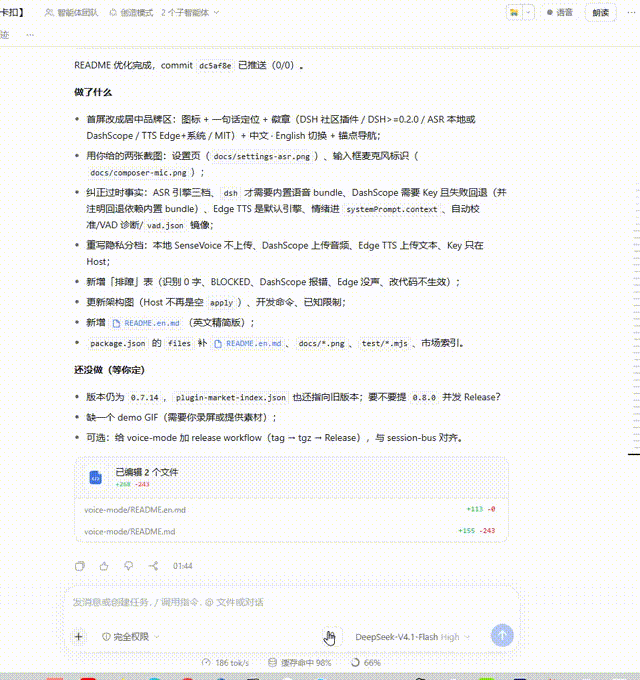
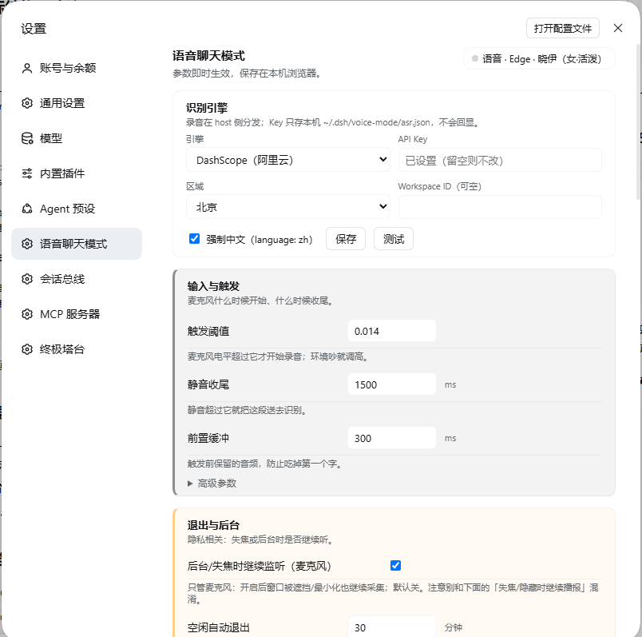
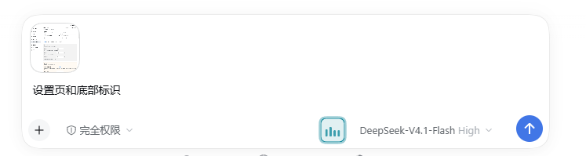

<div align="center">


# dsh-voice-chat-mode

**给 DeepSeek Harness 加一个语音聊天模式** —— 说话自动录音、自动转写、自动提交；回复用 Edge TTS 或系统语音念出来，支持多段口播稿。


**中文** · [English](README.en.md)

[特性](#特性) · [安装](#安装) · [快速开始](#快速开始) · [识别引擎](#识别引擎) · [播报](#播报) · [隐私](#隐私与安全) · [排障](#排障) · [开发](#开发)

</div>

DSH 自带语音输入能转写，但缺一条顺手的交互链：常驻监听、自动提交、可切换云端 ASR、口播稿控制、模型主动开麦。这个插件把这几块接起来，并保留一个原则：**录音默认只在本机识别，云端引擎必须由你显式选择**。


<p align="center"><sub>说话 → 自动转写并提交 → 回复按口播稿播报（30 秒演示）。</sub></p>


<p align="center"><sub>设置页：识别引擎（本地 / DashScope / off）、触发参数、退出与后台策略。</sub></p>


<p align="center"><sub>输入框右侧的麦克风标识：语音模式入口；开启后进入常驻监听。</sub></p>

---

## 特性

- **常驻监听**：RMS 门限 + 最短语音时长自动开始/结束录音，不需要点按钮。
- **自动提交**：转写文本走当前会话的 `beginSubmission` + `prompt`，默认 `queue`；长按麦克风 500ms 可把下一次说话标记为 `steer`（插话）。
- **可切换识别引擎**：`dsh`（DSH 内置 SenseVoice，本地、无需 Key）、`dashscope`（阿里云 Qwen ASR，需要 Key，失败自动回退 dsh）、`off`。
- **可校准 VAD**：设置页「自动校准」采样环境底噪，算建议阈值（下限 0.008，降幅过大有警告，可撤销）；诊断里记录 `vad` 行（有声占比、峰值、p90 等）。
- **双 TTS 引擎**：Edge TTS（8 个中文音色，默认晓伊 +10%）与系统 `speechSynthesis` 一键切换；Edge 失败自动回退系统语音。
- **多段口播稿**：回复里可放多段 `[voice-note]: <…>`，按顺序朗读；没有口播稿时回退念正文前 3 句。
- **模型可控制**：`voice_mode` 工具支持 enable / disable / speak / status；模型可主动开麦、说话或在自动化流程里报进度。
- **状态与诊断**：会话级开关、切会话自动恢复、硬关闭路径明确；诊断日志落 `~/.dsh/voice-mode/diag-YYYY-MM-DD.jsonl`。
- **情绪进上下文**（DashScope）：识别返回的 `emotion` / `language` 会写进 `systemPrompt.context` 的 `lastVoiceEmotion`（5 分钟过期），模型可感知“刚才那句是什么语气”。

## 安装

要求：DSH ≥ 0.2.0；浏览器/Electron 有麦克风权限。插件本身不调用模型，不需要额外 API Key（**除非你选择 DashScope 引擎**）。

### 方式一：插件页（推荐）

Harness 侧栏 **插件 → 添加插件**，填入仓库地址：

```text
https://github.com/BeepFlyer/dsh-voice-chat-mode
```

安装后点 **立即启用**，刷新页面（`Ctrl+R`）；顶栏出现麦克风与朗读按钮、设置页出现「语音聊天模式」即成功。

本仓库也带插件市场索引，可在「插件页 → 发现 → 添加索引源」填入：

```text
https://raw.githubusercontent.com/BeepFlyer/dsh-voice-chat-mode/main/plugin-market-index.json
```

### 方式二：命令行

```sh
dsh plugin --profile desktop add github:BeepFlyer/dsh-voice-chat-mode
```

本地开发（改代码直接作用于该副本）：

```sh
git clone https://github.com/BeepFlyer/dsh-voice-chat-mode
dsh plugin --profile desktop add link:/path/to/dsh-voice-chat-mode
```

### 依赖分档（按你选的引擎）

| 组件 | 何时需要 | 说明 |
|---|---|---|
| DSH 内置实验语音 bundle（`dsh-experimental-voice-input-bundle`） | 只在 `engine=dsh` 时需要 | 提供本地 SenseVoice 转写；首次使用前在插件页完成模型下载（约 230 MB，到用户自己的 `~/.dsh/speech-to-text/`） |
| DashScope API Key | 只在 `engine=dashscope` 时需要 | 设置页填 Key，或写入 `~/.dsh/voice-mode/asr.json`；只在 Host 侧保存，不回显、不进日志 |
| Edge TTS（Python 包） | `tts=edge`（默认） | 插件自带 `vendor/python`（edge-tts 7.3.1）；缺失时会自动尝试 `pip install --target vendor/python` |
| 系统语音 `speechSynthesis` | 回退/离线 | 操作系统提供，零依赖 |

## 快速开始

1. 安装并启用插件，刷新页面；
2. 设置 → **语音聊天模式**：选择识别引擎（本地或 DashScope）、确认播报引擎；
3. 点顶栏麦克风（或让 agent 调 `voice_mode enable`）；
4. 说一句「测试测试」——消息会以 `[语音] 测试测试` 的形式提交；
5. 助手回复时，`[voice-note]` 段落会被念出来；没有口播稿则念正文前 3 句。

**识别 0 字先看这里**：设置页「自动校准」跑一次；确认系统麦克风增益不是太低（Windows 可在声音设置里调到 100）；看诊断里的 `vad` 行——`voicedRatio` 很低通常意味着音量不够或阈值不对。

## 识别引擎

设置页「识别引擎」卡片：

| 引擎 | 转写位置 | Key | 依赖 | 失败行为 |
|---|---|---|---|---|
| `dsh`（默认） | 本机 SenseVoice（CPU） | 不需要 | 内置实验语音 bundle + 模型 | 进入 `BLOCKED`，提示准备模型 |
| `dashscope` | 阿里云 Qwen ASR | 需要 | 无（不需要内置语音 bundle） | 自动回退 `dsh`；诊断记录 `fallbackFrom=dashscope-auth` 等 |

> 注意：`dashscope` 的回退目标是 `dsh`，因此本机仍需具备 DSH 内置语音 bundle / 模型才能回退成功；如果内置语音 bundle 已被移除，云端失败时就没有本地回退可用。
| `off` | 不识别 | — | — | 语音模式只做播报 |

DashScope 配置：

- Key 存在 `~/.dsh/voice-mode/asr.json`（仅在 Host 读取；**不要提交进仓库**）；
- 支持区域 `cn-beijing` / `ap-southeast-1` / `us-east-1` 与可选 Workspace ID；
- 「测试」按钮会发一次真实请求确认 Key 可用；
- 失败回退：鉴权失败、限流、超时、网络错误都会回退到 `dsh`，语音不会断。

> 说明：DashScope 需要把**音频**发到阿里云；如果不想上传音频，用 `engine=dsh`（本地）或 `off`。

## 播报

| 引擎 | 说明 | 依赖 |
|---|---|---|
| `edge`（默认） | Edge TTS 神经语音，8 个中文音色（晓晓/晓伊/云健/云希/云夏/云扬/晓北/晓妮），默认晓伊 +10% | 联网 + 插件自带/自动安装的 edge-tts |
| `system` | 本机 `speechSynthesis`，离线、音色取决于系统 | 无 |

- 顶栏有**麦克风开关**与**「朗读/静音」键**：后者只控制助手回复自动朗读，立即生效并持久化；`voice_mode speak` 不受它影响。
- 播报中按 `Esc` / 点顶栏 / 切会话只停当前这一句；失焦默认让当前句播完。
- 失败回退：断网/超时/接口错误自动切系统语音并在诊断里记一条；可在设置里关掉回退。

### 口播稿协议

语音输入时（用户消息以 `[语音] ` 开头），助手可在回复的不同阶段插入多段：

```
[voice-note]: <一到三句口语化的话：结论 / 下一步 / 需要注意什么。>
```

- 尖括号是 Markdown 链接引用定义的合法目标，渲染时被吃掉、聊天里不可见；
- 插件按出现顺序逐段朗读；完全没有口播稿时才回退念正文前 3 句；
- 建议把约定写进工作区 `AGENTS.md`，让不同会话的 agent 都遵守。

## 设置项（摘要）

设置页有约 20 项参数，常用几项：

| 参数 | 默认 | 说明 |
|---|---|---|
| 触发阈值（RMS） | 0.01（可校准） | 高于它才认为在说话；环境吵就调高 |
| 静音收尾 | 1500ms | 静音超过它就送识别 |
| 前置缓冲 | 300ms | 防吃第一个字 |
| 最短说话时长 | 300ms | 短于此不触发（键盘声） |
| 单段上限 / 最短字数 / 连续失败上限 | 60s / 2 / 3 | 录音与降级保护 |
| 空闲自动退出 / 失焦自动退出 | 10 分钟 / 0 | 0 = 不自动退出 |
| 后台继续监听 | 关 | 最小化/切标签时是否继续采集 |
| 语音消息标记 | `[语音] ` | 加在语音提交的消息前 |
| 播报引擎 / 音色 / 语速 | edge / 晓伊 / +10% | Edge TTS 参数 |
| 播报范围 / 字数上限 / 跳过开场白 | 前 3 句 / 220 / 开 | 正文回退的裁剪策略 |
| 播报时忽略触发 / 允许说话打断 | 开 / 开 | 播报与 VAD 的互斥策略 |

完整参数表与诊断面板在设置页内。

<details>
<summary><b>高级：诊断与校准数据</b></summary>

- 诊断日志：`~/.dsh/voice-mode/diag-YYYY-MM-DD.jsonl`，设置页可打开目录；
- VAD 行：`{"durationMs":…,"voicedMs":…,"voicedRatio":…,"thresholdUsed":…,"peakRms":…,"p90Rms":…}`；`voicedRatio < 0.2` 通常意味着切片失败（音量太低或阈值太高）；
- ASR 行带 `engine / fallbackFrom / emotion / language`，可区分本地、云端与回退路径；
- 校准结果与撤销值存在浏览器 `localStorage`，同时阈值会镜像到 `~/.dsh/voice-mode/vad.json`（启动时文件优先，缺失回退 localStorage）。

</details>

## 隐私与安全

| 数据 | 去哪里 | 触发条件 |
|---|---|---|
| 录音音频 | 只在本机浏览器→Host 回环接口；SenseVoice 在 Host CPU 推理 | `engine=dsh`（默认） |
| 录音音频 | **发给阿里云 DashScope** 做识别 | 你显式选择 `engine=dashscope` |
| 要朗读的文本 | **发给微软 Edge 朗读端点**（HTTPS） | `tts=edge` |
| 要朗读的文本 | 本机 `speechSynthesis` | `tts=system`（或回退） |
| API Key | 只在 Host 侧 `~/.dsh/voice-mode/asr.json`，不回显、不写日志 | DashScope |

- Host 路由在 `/api` 认证栅栏内，只接受已认证的本机浏览器；默认监听回环；
- 无遥测；诊断只在本机；
- 模型不随插件分发：本地模型由 DSH 语音 bundle 各用户自行下载；Edge TTS 的 Python 依赖随插件 `vendor/python` 分发，或首次缺失时自动安装。

## 排障

| 现象 | 先查 |
|---|---|
| 说半天识别 0 字 | 系统麦克风增益/音量；设置页「自动校准」；诊断 `vad` 行的 `voicedRatio`/`p90Rms` |
| 一直不触发 | 阈值是否被手动调得太高（当前值显示在输入区卡片上）；`vad` 的 `peakRms` |
| `state=BLOCKED` | 麦克风权限、是否被其他窗口占用、`engine=dsh` 时内置语音模型是否已准备 |
| DashScope 无结果/报错 | 设置页「测试」；看诊断 `asr.fallbackFrom`；检查 Key/区域/Workspace |
| Edge TTS 没声 | 设置页依赖状态；诊断 `edge tts failed`；`python -m edge_tts --list-voices` 是否可跑通 |
| 改了代码/设置不生效 | client bundle 需刷新页面；Host 改动需重载插件；必要时重启 DSH |
| 两个窗口抢麦 | `navigator.locks` 会置灰并提示；同一时间只允许一个窗口占麦 |

## 架构

```
voice-mode/
├── index.js              # Host：ASR 路由、Edge TTS、systemPrompt、voice_mode 工具
├── client-body.js        # 可读源码：状态机、VAD、校准、UI、播放器
├── client.js             # 生成物：loader 工厂 + speech Remote + client-body
├── scripts/build-client.mjs
├── cordis.patch.yml      # 覆盖内置 ui-voice-input 行（含维护注释）
├── locale/ icon.svg
├── vendor/python/        # edge-tts 及依赖（Win + CPython 3.12 轮子）
└── test/                 # Host 路由 / 播放器 / 工具的离线测试
```

- **采集**：`getUserMedia`（AEC + NS）→ `ScriptProcessorNode` 取 PCM → pre-roll 环形缓冲 → 16k mono WAV；
- **识别**：`engine=dsh` 走 DSH 内置 `speechToText` Remote；`engine=dashscope` 走 Host 的 `/api/voice-mode.asr`；
- **提交**：`ctx.sessions.retain()` → `beginSubmission`/`prompt`；硬关闭用 `cancel()`；
- **播报**：客户端按句 `POST /api/voice-mode.tts` → Host 调 `vendor/python` 的 edge-tts → `audio/mpeg` → 客户端播放；失败回退 `speechSynthesis`；
- **模型面**：系统提示词节 + `systemPrompt.context`（含 `lastVoiceEmotion`）+ `voice_mode` 工具。

## 开发

```bash
node scripts/build-client.mjs      # 从 app.asar 读 speech Remote，重建 client.js
node scripts/build-client.mjs --check
node test/host-route.mjs && node test/edge-player.mjs && node test/tools.mjs
```

改 `client-body.js` 后需要 build；改 Host `index.js` 后重载插件；client 改动刷新页面生效。诊断/校准怎么读见上面的「高级」。

## 已知限制

- 只实测 Windows 10/11 + DSH Desktop；Web profile 理论可用（回环 + 麦克风权限）；
- 不支持唤醒词、流式字幕、音色克隆；
- 情绪/语言只来自 DashScope；本地 SenseVoice 不返回 emotion；
- 播报按句，不是流式；系统语音音色取决于操作系统；
- 覆盖内置 `ui-voice-input` 行，不要同时启用两支麦克风插件；DSH 大版本升级时按 `cordis.patch.yml` 维护注释核对。

## 许可

MIT，见 [LICENSE](LICENSE)。插件覆盖了 DSH 内置包的行，升级 DSH 时请对照维护注释检查兼容性。
